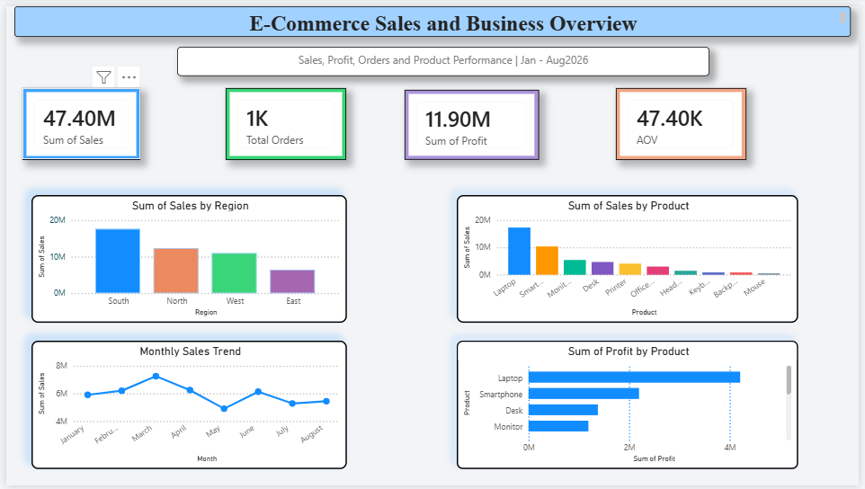
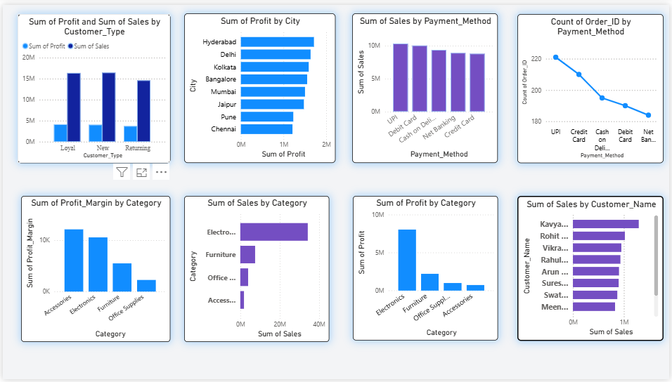
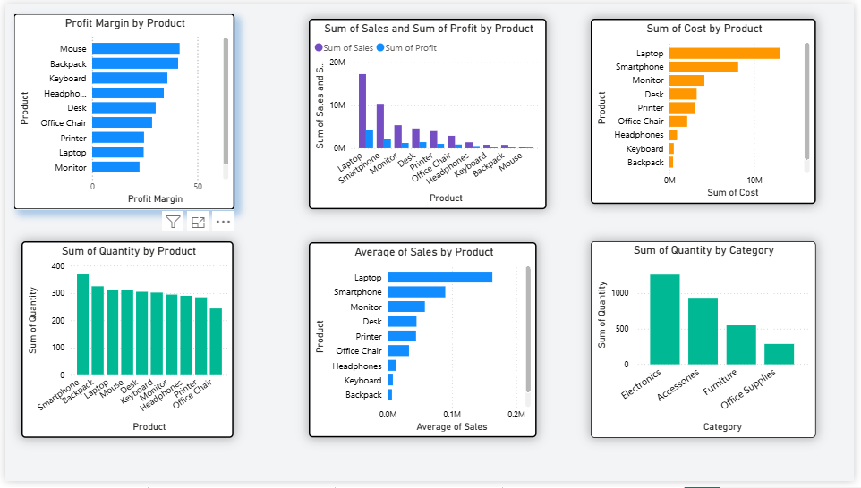
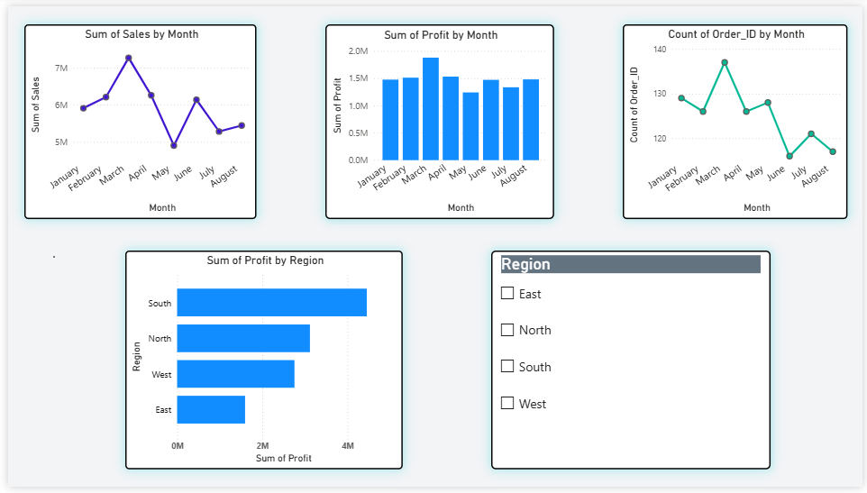

# E-commerce Sales Analysis

E-commerce sales data analysis using Python, SQL and Power BI.

## Tools Used
- Python (Pandas) in Google Colab for data cleaning and analysis
- SQL for querying and aggregating sales data
- Power BI for the interactive dashboard

## Dashboard Preview

### Page 1: Executive Sales Overview

### Page 2: Customer and Business Analysis

### Page 3: Product and Profit Analysis

### Page 4: Monthly and Regional Analysis

## Author
Goutham R | [LinkedIn](https://linkedin.com/in/goutham06)
